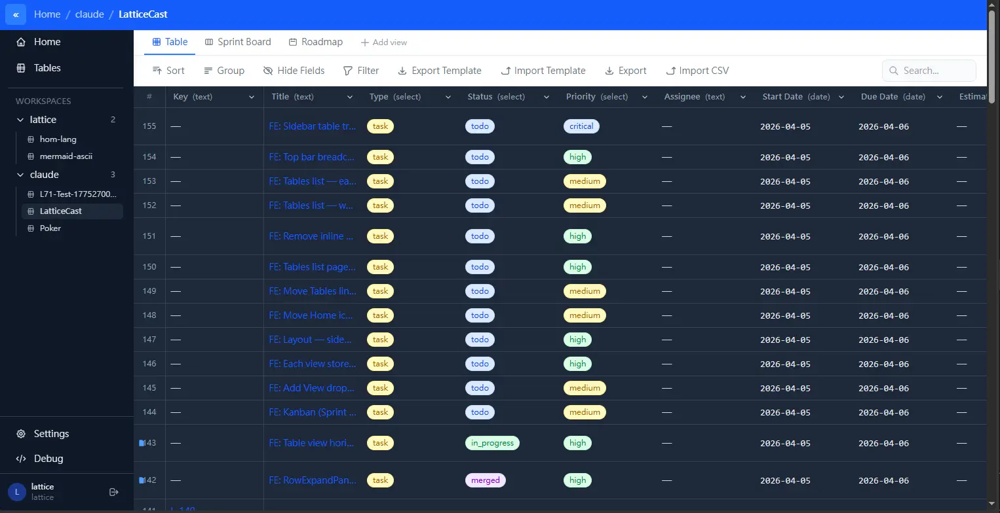

# LatticeCast

Self-hosted Airtable-like table engine and unified backend. Flexible JSONB tables, customizable views (Table, Kanban, Timeline, Dashboard, Workflow), first-party SSO, and S3-compatible file storage. Project management and CRM are templates on the same engine, and any Svelte (or other) front end can be built on the same API.



## Features

| Tool | Sidebar Tree | Table Grid | Horizontal Scroll | PM Features | Custom Fields |
|------|-------------|------------|-------------------|-------------|---------------|
| Linear | ✅ | ❌ (cards) | ❌ | ✅ | ❌ |
| Notion | ✅ (page tree) | ✅ | ❌ | Partial | ✅ |
| Airtable | ✅ | ✅ | ✅ | ❌ | ✅ |
| Jira | ✅ | ❌ (list) | ❌ | ✅ | Partial |
| VS Code | ✅ | ❌ | ❌ | ❌ | ❌ |
| **LatticeCast** | ✅ | ✅ | ✅ | ✅ | ✅ |

- **Flexible Schema** — create columns of any type (text, number, date, select, tags, checkbox, url), all stored as JSONB
- **Workspaces** — multi-user, with `read` / `write` / `owner` access levels enforced by PostgreSQL row-level security
- **Views** — Table (spreadsheet), Kanban (drag-and-drop), Timeline/Gantt (date bars), Dashboard (LatticeQL charts, numbers, lists) and Workflow (node graph), all customizable
- **PM Template** — Jira-like project management with epic/story/task/bug types, Sprint Board (Kanban) and Roadmap (Timeline) views; ticket key is `<type>-<row_id>` (e.g. `story-5`)
- **CRM Template** — Pipeline Kanban plus a Sales Dashboard whose blocks are LatticeQL queries over the same rows
- **Per-column Indexes** — auto-managed PG B-tree (number/date) and GIN (select/tags) indexes
- **Blob cells** — a `blob` column holds exactly one file (`file`, `image`, `text`, `table` kinds) in RustFS; PM tickets use a `text` blob for Markdown notes
- **Import** — CSV/JSON import and templates in the table UI
- **Authentication** — LC-local HS256 JWTs, password login with rotating refresh tokens, and a first-party SSO issuer (authorization code + PKCE, native handoff) so static front ends need no auth backend
- **Unified backend** — one generic workspace/table API; different front-end apps differ only in schema and view configuration

## Data Model

```
workspaces        → workspace_id UUID; workspace_name
workspace_members → one row per granted action: read | write | owner (owner = all three)
tables            → table_id BIGINT (global, DB-assigned); table_name unique per workspace;
                    config JSONB = ordered columns, view_order, default_view
table_views       → (table_id, view_id); config JSONB = {name, type, ...}
rows              → (table_id, row_id); row_data JSONB keyed by column UUID
RustFS            → one-file blob cells at {workspace_id}/{table_id}/rows/{row_id}/blobs/{column_id}/{object}
```

Children (`rows`, `table_views`) carry no `workspace_id`; the workspace is the parent table's, and RLS resolves permitted `table_id`s from workspace grants. Every RDS timestamp is a UTC `TIMESTAMPTZ`; `date`/`datetime` cells inside `row_data` are epoch-millisecond numbers. See `llm.root.md` and `llm.core.md`.

## Tech Stack

| Layer | Technology |
|-------|------------|
| Frontend | SvelteKit 2, Svelte 5, Tailwind CSS 4, TypeScript, Vite 7 |
| Backend | FastAPI, Python 3.12, Uvicorn |
| Database | PostgreSQL 18, JSONB + auto-managed indexes |
| Cache | PostgreSQL UNLOGGED table (`private.cache`) |
| Query language | LatticeQL (`.lattice-ql`) — compiles dashboard queries to PostgreSQL JSONB SQL |
| Storage | RustFS (S3-compatible) — blob cells and per-user files |
| Auth | LC-local JWT, password login, first-party SSO |

## Quick Start

```bash
docker compose up -d
# Frontend: http://localhost:13491
# Backend:  http://localhost:13491/api/v1/
# API docs: http://localhost:13491/api/v1/docs
```

## URL Pattern

```
/<workspace>/<table>          — table detail; <workspace> is a name or UUID, <table> is a table_name
                                (a numeric <table> still resolves as a table_id bookmark)
/<workspace>/<table>?view=X   — specific view
/tables                       — tables list
```

Browser URLs use names; backend requests always use the numeric `table_id`. If a name matches several tables, the first-created one wins.

## PM Workflow

```
1. Create PM project from template (epic/story/task/bug + Kanban + Timeline views)
2. Create tickets → keys derive from type and row id (e.g. `story-1`, `bug-2`)
3. Developer picks ticket → branch → implement → test → merge
4. Status moves through todo → in_progress → testing → review → done → merged (a select column; transitions are made by people or the agent tooling in `.agent-skills`, not by the backend)
5. Ticket text blobs in RustFS track specs/notes per ticket
```

## Views

All views render the same JSONB data — just different presentations:

| View | Description |
|------|-------------|
| **Table** | Spreadsheet grid with sort/group/filter/search |
| **Kanban** | Cards grouped by any select column, drag-and-drop |
| **Timeline** | Horizontal date bars, configurable start/end/color/group |
| **Dashboard** | Grafana-like blocks (`chart`, `number`, `list`); each block runs a LatticeQL query server-side under the caller's RLS |
| **Workflow** | Node graph over rows (name, type, nexts, position) |
